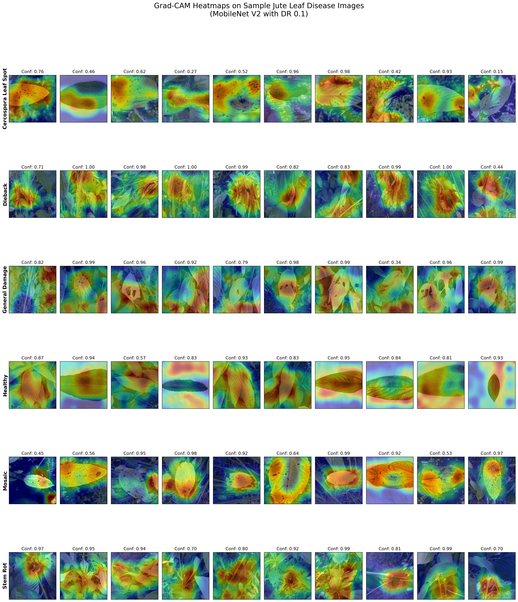
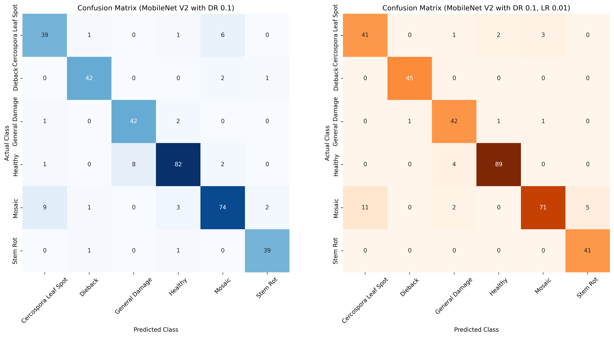

# jute-disease-detection <!-- omit from toc -->

<div align="center">
  
  <p><i>Grad-CAM: Visualizing model focus on disease symptoms.</i></p>

  <br>

  
  <p><i>Model Convergence: Training and Validation metrics.</i></p>

  <br>

  
  <p><i>Performance Benchmark: Multi-class Confusion Matrix evaluation.</i></p>
</div>

<!-- Refer to <https://shields.io/badges> for usage -->

[](https://doi.org/10.5281/zenodo.23414231) 
      

Benchmarking classical machine learning and transfer learning on a merged six-class jute leaf disease dataset. Created for CSC713M (Machine Learning for MSCS); the short paper was submitted to IEEE HNICEM 2026 ([PDF](docs/hnicem2026-paper.pdf), [full paper](https://drive.google.com/file/d/1DbaQ4TWEHChkLTLvpzntbUxhkBkSmQ5o/view?usp=drive_link)).

## Table of Contents <!-- omit from toc -->

- [1. Introduction](#1-introduction)
- [2. Project Structure](#2-project-structure)
- [3. Getting Started](#3-getting-started)
  - [3.1. Technical Prerequisites](#31-technical-prerequisites)
  - [3.2. Data \& Platform Credentials](#32-data--platform-credentials)
  - [3.3. Installation](#33-installation)
- [4. Reproducing the Results](#4-reproducing-the-results)
- [5. Training from Scratch](#5-training-from-scratch)
- [6. Benchmarked Performance](#6-benchmarked-performance)
- [7. Citation](#7-citation)
- [8. License](#8-license)
- [9. References](#9-references)

## 1. Introduction

This project explores classical machine learning and deep learning approaches for **jute leaf disease classification** using a unified dataset constructed from multiple open-access sources. We combine and preprocess jute leaf disease images into six classes: **Cercospora Leaf Spot, Dieback, General Damage, Healthy, Mosaic, and Stem Rot**. We then use the unified dataset to benchmark both handcrafted-feature ML pipelines and transfer-learning-based DL models.

Our experiments compare classical ML models such as **Random Forest** and **Support Vector Machine** against deep learning architectures, including **EfficientNet, ResNet, Inception, MobileViT, and MobileNetV2**. Among the evaluated deep learning models, **MobileNetV2** offered the best practical balance of efficiency and performance, achieving the strongest test accuracy while remaining compact enough for resource-constrained settings.

Beyond benchmarking, this project also investigates **fine-tuning on related plant disease datasets, input resolution effects, feature-space analysis with t-SNE/UMAP, error analysis, and Grad-CAM interpretability**. The results suggest that confusion between **Mosaic** and **Cercospora Leaf Spot** remains a key challenge, likely due to visual similarity and dataset limitations, motivating future work in improved preprocessing and multi-label disease recognition.

Our short paper, **"Benchmarking Classical Machine Learning and Transfer Learning for Data-Constrained Jute Leaf Disease Classification"**, was submitted to IEEE HNICEM 2026 ([PDF](docs/hnicem2026-paper.pdf)). The [full paper with additional visualizations](https://drive.google.com/file/d/1DbaQ4TWEHChkLTLvpzntbUxhkBkSmQ5o/view?usp=drive_link) covers the complete results.

## 2. Project Structure

A high-level overview of the repository organization:

```text
.
├── configs/
│   └── historical/     # Lightning CLI and grid search configs for the reported runs
├── data/               # Dataset storage (git-ignored) and the tracked class list
├── docs/               # Architecture notes and the submitted paper
├── notebooks/
│   └── historical/     # Notebooks and Jupytext pairs as run for the paper
├── results/
│   └── submitted/      # Committed logs and figures behind the reported numbers
│       ├── figures/    # dl/ and ml/ figures
│       └── logs/       # CSV logs for baselines, grid searches and resolution runs
├── src/
│   └── jute_disease/   # Library package and the jute-disease console entry point
├── tests/              # Unit and API tests
├── .env.example        # Environment variables template
├── justfile            # Task runner: one recipe per study command
└── artifacts/          # Runtime output (git-ignored): checkpoints, features, logs
```

For a detailed look at the internal design, public APIs, and architectural decisions, see [architecture.md](docs/architecture.md).

## 3. Getting Started

### 3.1. Technical Prerequisites

Ensure you have the following installed on your local machine:

1. **Git:** Used to clone this repository.
2. **Python `>=3.11`:** (Managed by `uv` automatically if not present).
3. **uv:** Our unified Python package and project manager. Installation instructions: <https://docs.astral.sh/uv/getting-started/installation/>.

### 3.2. Data & Platform Credentials

This project automates data acquisition and experiment tracking via third-party APIs:

1. **Jute dataset:** The unified six-class dataset is distributed as `data.zip` in this [Google Drive folder](https://drive.google.com/drive/folders/1WoQ-Xzy0Prl9lInHW5JpGX4tpE9YDUua?usp=sharing). Unzip it into the project root so that `data/by_class/` exists. See [References](#9-references) for the three source datasets it merges.
2. **Kaggle API:** Only needed to download the PlantVillage (Hughes & Salathé, 2015; Mohanty et al., 2016) and PlantDoc (Singh et al., 2020) pretraining datasets (`just data-download`, which pins the Kaggle package versions). Ensure you have a `kaggle.json` in `~/.kaggle/`.
3. **Weights & Biases (WandB):** Used for experiment logs and interactive dashboards. Run `wandb login` before starting deep learning training.

The unified jute dataset merges three public sources. The repository code is Apache-2.0; the data keeps its original terms:

| Source                                                                  | Terms                                      |
| :---------------------------------------------------------------------- | :----------------------------------------- |
| Islam & Sheikh, Harvard Dataverse (`doi:10.7910/DVN/FJ1DM1`)            | CC0 1.0                                    |
| Mridha, Mendeley Data (`z87b9hnkh7`)                                    | CC BY 4.0 (attribute the author)           |
| Jannat et al., Kaggle (`mdsaimunalam/jute-leaf-disease-detection`)      | Publicly available on Kaggle, no licence stated; used with attribution (Jannat et al., 2025) |

### 3.3. Installation

1. Clone this repository:

   ```bash
   git clone https://github.com/qu1r0ra/jute-disease-detection
   ```

2. Navigate to the project root and install all dependencies:

   ```bash
   cd jute-disease-detection
   uv sync
   ```

3. Copy the environment template and set your W&B key:

   ```bash
   cp .env.example .env
   ```

4. Optional: install [`just`](https://just.systems) to run the recipes shown below. `just --list` shows every recipe, and each one wraps a single `uv run jute-disease` command. `uv run jute-disease --help` lists the commands themselves.

## 4. Reproducing the Results

Run through the Jupyter notebooks in `notebooks/historical/` in numerical order. These are the notebooks as run for the paper; they predate the current module layout and still import the old paths, so the `jute-disease` commands in the next section are the maintained route to the same experiments:

1. **`01_Exploratory_Data_Analysis.ipynb`**
   Consolidates the unified jute dataset and visualizes initial class distributions.
2. **`02_Model_Selection_Training_DL.ipynb`**
   Executes the baseline deep learning benchmarks (EfficientNet, MobileNetV2, etc.).
3. **`02_Model_Selection_Training_ML.ipynb`**
   Extracts handcrafted features (HOG, LBP, Color Hist) for classical ML training.
4. **`03_Model_Analysis_Tuning_DL.ipynb`**
   Performs deep learning hyperparameter tuning and generates Grad-CAM heatmaps.
5. **`03_Model_Analysis_Tuning_ML.ipynb`**
   Performs ML error analysis and hyperparameter tuning (Grid Search).
6. **`04_Model_Evaluation.ipynb`**
   Finalizes evaluation on the held-out test set and identifies top failure modes.

> [!NOTE]
> The notebooks were run on Google Colab (CPU for classical ML, L4 GPU for deep learning), and the Colab badges at the top of each notebook open them there. To run locally, select the **`.venv`** in the project root as your Jupyter kernel and skip the Drive-mounting cells. Each notebook is paired with a `.py` file through Jupytext (`just sync-nb`).

Alternatively, `just` drives the same experiments from the command line (see `just --list`): `just train-dl`, `just grid-search`, `just grid-search-finetune`, `just train-dl-512`, and `just train-ml`. Experiment logs behind the reported deep learning numbers are committed under `results/submitted/logs/`.

## 5. Training from Scratch

To retrain the models from the command line instead of the notebooks:

1. Install dependencies (`uv sync`) and unzip `data.zip` so that `data/by_class/` exists ([3.2](#32-data--platform-credentials)).
2. Freeze the leakage-controlled 70/15/15 split (seed 42) and download the PlantVillage/PlantDoc pretraining data:

   ```bash
   just freeze --image-root <path-to-original-images>   # curation, identity groups, manifest and receipt
   just freeze-cache                                      # optional bounded train/val image cache and its decision
   just data-download
   just freeze-source plantdoc data/external/plantdoc --package-version 7
   ```

   The freeze writes `artifacts/freeze/target/` (manifest plus a receipt that hashes every input). Training reads partitions only through that manifest, and a directory without its receipt is never treated as a completed freeze.

3. Point experiment tracking at your own W&B account. The configs log to the `grade-descent` entity, so either edit `entity` in the `WandbLogger` block of the files under `configs/historical/`, or run offline with `WANDB_MODE=offline`.
4. Smoke-test the pipeline, then train:

   ```bash
   just train-dl-check                 # one-batch fast_dev_run (MobileNetV2)
   just train-dl                       # all six deep learning baselines
   just train-dl-single mobilenet_v2   # one baseline by config name
   just train-ml                       # handcrafted features + classical ML
   ```

5. Reproduce the MobileNetV2 tuning in the paper (phase 1: transfer-learning/dropout; phase 2: learning rate and weight decay) and the 512 px experiment:

   ```bash
   just grid-search
   just grid-search-finetune
   just train-dl-512
   ```

Deep learning runs can also be driven directly through the Lightning CLI, for example `uv run jute-disease train dl fit --config configs/historical/baselines/mobilenet_v2.yaml`. On Windows without a C++ compiler, `torch.compile` fails; add `--model.compile_model=false` to that command.

Checkpoints are written to `artifacts/checkpoints/` and CSV logs to `artifacts/logs/`. Optional source pretraining requires a completed source intake: record the package version and independently established inventory digest with `just freeze-source`, then pass its manifest, the source image root, the frozen target manifest and an output path to `just pretrain`. Intake blocks if class support or the package identity cannot be established. Training on a GPU is recommended for the deep learning runs; the classical ML pipeline runs on CPU.

## 6. Benchmarked Performance

Below is a summary of our primary results on the held-out test split (360 images). The [full paper](https://drive.google.com/file/d/1DbaQ4TWEHChkLTLvpzntbUxhkBkSmQ5o/view?usp=drive_link) discusses learning rates, input resolutions, and feature-space analysis in detail.

| Model Class       | Architecture / Classifier                  | Features / Training       | Val Acc (%) | Val Macro-F1 (%) | Test Acc (%) |
| :---------------- | :----------------------------------------- | :------------------------ | :---------- | :--------------- | :----------- |
| **Deep Learning** | MobileNetV2 (LR = 0.01)                    | Fine-tuned ImageNet       | 88.76       | 89.11            | **91.39**    |
| **Deep Learning** | EfficientNet-B5 (baseline)                 | Fine-tuned ImageNet       | 90.44       | 90.41            | 88.61        |
| **Classical ML**  | Random Forest (tuned)                      | HOG + LBP + GLCM + Gabor + HSV | -      | 77.73            | 72.22        |

Model selection used validation metrics. Results come from a single stratified 70/15/15 split (seed 42) without near-duplicate removal, so differences of a point or two are within noise.

### Pretrained Weights

The best MobileNetV2 (learning rate 0.01, weight decay 0.05, frozen backbone, 91.39% test accuracy) is attached to the [v1.0.0 release](https://github.com/qu1r0ra/jute-disease-detection/releases/tag/v1.0.0) as `mobilenet_v2_jute.pt` (SHA-256 `f172c2668378f6a59376928f3d55e1562e289dd954c29b74e5054c978edcad9d`). It is the Weights & Biases `best` checkpoint of run `af60c7b9` as a plain `state_dict`. Class indices follow `data/disease_classes.txt`. The architecture is MobileNetV2 (Sandler et al., 2018), loaded through the timm library (Wightman, 2019).

```python
import torch
from PIL import Image
from torchvision import transforms as T

from jute_disease.models.dl.backbone import TimmBackbone
from jute_disease.models.dl.classifier import Classifier

classes = [c.strip() for c in open("data/disease_classes.txt") if c.strip()]
model = Classifier(
    TimmBackbone("mobilenetv2_100.ra_in1k", pretrained=False),
    num_classes=len(classes),
    compile_model=False,
)
model.load_state_dict(torch.load("mobilenet_v2_jute.pt", weights_only=True))
model.eval()

preprocess = T.Compose(
    [
        T.Resize(256),
        T.CenterCrop(256),
        T.ToTensor(),
        T.Normalize([0.485, 0.456, 0.406], [0.229, 0.224, 0.225]),
    ]
)
image = preprocess(Image.open("leaf.jpg").convert("RGB")).unsqueeze(0)
with torch.no_grad():
    print(classes[model(image).argmax(1).item()])
```

## 7. Citation

If you find this research or codebase useful in your own work, please consider citing our paper. The code and weights are archived on Zenodo ([10.5281/zenodo.23414231](https://doi.org/10.5281/zenodo.23414231), which always resolves to the latest version):

```bibtex
@inproceedings{bunyi2026jute,
  title={Benchmarking Classical Machine Learning and Transfer Learning for Data-Constrained Jute Leaf Disease Classification},
  author={Bunyi, Christian Joseph and Umali, Immanuel},
  booktitle={IEEE 2026 International Conference on Humanoid, Nanotechnology, Information Technology, Communication and Control, Environment, and Management (HNICEM)},
  year={2026},
  note={Submitted},
  url={https://github.com/qu1r0ra/jute-disease-detection}
}
```

## 8. License

This project is licensed under the **Apache License 2.0**. See the [LICENSE](LICENSE) file for the full text.

## 9. References

- Hughes, D. P., & Salathé, M. (2015). An open access repository of images on plant health to enable the development of mobile disease diagnostics. _arXiv preprint_. <https://arxiv.org/abs/1511.08060>

- Islam, M. M., & Sheikh, M. R. (2026). A comprehensive image dataset of jute diseases. _Data in Brief, 64_, 112334. <https://doi.org/10.1016/j.dib.2025.112334>

- Jannat, M., Uddin, M. S., Hasan, M. A., Alam, M. S., Paul, A., Chowdhury, M. E. H., & Haider, J. (2025). Real-time jute leaf disease classification using an explainable lightweight CNN via a supervised and semi-supervised self-training approach. _Frontiers in Plant Science, 16_. <https://doi.org/10.3389/fpls.2025.1647177>

- Mridha, M. H. (2024). _Jute plant leaves_ (Version 1) [Data set]. Mendeley Data. <https://doi.org/10.17632/z87b9hnkh7.1>

- Mohanty, S. P., Hughes, D. P., & Salathé, M. (2016). Using deep learning for image-based plant disease detection. _Frontiers in Plant Science, 7_. <https://doi.org/10.3389/fpls.2016.01419>

- Sandler, M., Howard, A., Zhu, M., Zhmoginov, A., & Chen, L.-C. (2018). MobileNetV2: Inverted residuals and linear bottlenecks. In _Proceedings of the IEEE/CVF Conference on Computer Vision and Pattern Recognition_ (pp. 4510–4520). <https://doi.org/10.1109/CVPR.2018.00474>

- Singh, D., Jain, N., Jain, P., Kayal, P., Kumawat, S., & Batra, N. (2020). _PlantDoc: A dataset for visual plant disease detection_. In _Proceedings of the 7th ACM IKDD CoDS and 25th COMAD_ (pp. 249–253). <https://doi.org/10.1145/3371158.3371196>

- Wightman, R. (2019). _PyTorch Image Models_ (timm) [Software]. GitHub. <https://doi.org/10.5281/zenodo.4414861>
